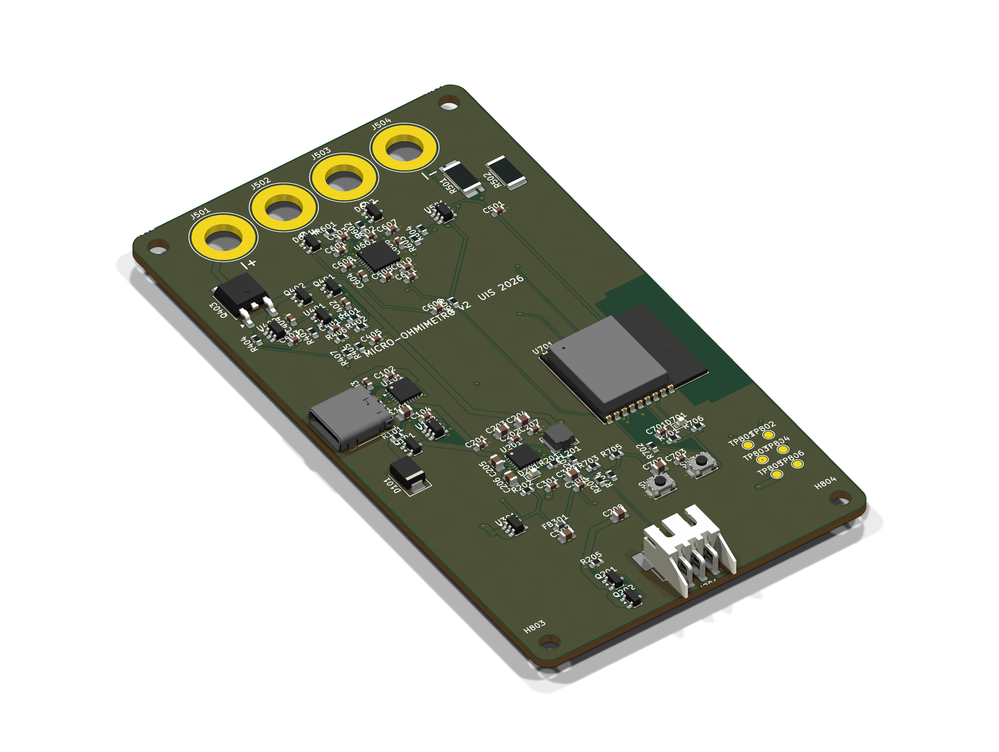

# Micro-ohmímetro de precisión (1 mΩ – 1 Ω) — versión 2

Proyecto de la asignatura **Diseño de Sistemas Electrónicos** de la Universidad Industrial de Santander (E3T), dictada por el profesor Jaime Barrero.
Autores: **Edward Andrés Pacheco Jurado** (2222236) y **Joseph Thomas Albarracín Contreras** (2220415), 2026.

Es un instrumento portátil con medición Kelvin de 4 hilos. Usa **corriente pulsada de dos niveles (1,042 A / 0,502 A)** y **medición ratiométrica**, con un ADC sigma-delta **AD7124-4** que aprovecha su PGA. El control lo hace un **ESP32-C3**, con BLE y OTA. Se alimenta de una **LiPo 1S de 2000 mAh** integrada en la PCB, que se carga por **USB-C Power Delivery** con un **BQ25895**.

## Contenido del repositorio
| Carpeta | Contenido |
|---|---|
| [`informe/`](informe/) | **Informe final** en PDF y su fuente LaTeX (`main.tex` y figuras) |
| [`hardware/kicad/`](hardware/kicad/) | Proyecto KiCad 10: esquemático jerárquico de 9 hojas, PCB de 4 capas, librería propia y scripts generadores (`gen/`) |
| [`hardware/fabricacion/`](hardware/fabricacion/) | Gerbers con taladros (ZIP), archivo de posiciones (pick & place) y modelo **STEP** |
| [`simulaciones/`](simulaciones/) | Netlists PSpice (`.cir`, `circuito_v2.inc`), datos `.csv` y resumen de resultados |
| [`imagenes/`](imagenes/) | Esquemáticos en SVG/PDF, renders 3D, plano acotado y capas de cobre |
| [`docs/`](docs/) | Diseño detallado (B1), BOM, resumen del esquemático (B3) e informes de las etapas 1–7 |

## Cómo abrir y verificar
- **Esquemático y PCB:** abrir `hardware/kicad/microohmetro_v2.kicad_pro` en **KiCad 10**. La librería propia se carga sola desde `Librerias/` gracias a `sym-lib-table`.
- **Regenerar el esquemático o la PCB:** `python gen/gen_sch3.py` y `python gen/gen_pcb.py`, con el Python que trae KiCad.
- **Simulaciones:** `psp_cmd.exe <archivo>.cir` (Cadence PSpice 22.1). **Los modelos de TI no se redistribuyen**; descárgalos y colócalos en `simulaciones/modelos/`:
  - OPA4388 (equivalente al OPA388): https://www.ti.com/lit/zip/sbomaz6 → `modelos/opa4388_pspice/OPA4388.LIB`
  - INA181A1: https://www.ti.com/lit/zip/sbombb7 → `modelos/ina181a1_pspice/ina181a1.lib`
- **Informe:** subir `informe/` a Overleaf (pdfLaTeX).

## Resultados principales
| Ítem | Valor |
|---|---|
| Error DC ratiométrico simulado | −0,0054 % (sistemático, se calibra) |
| FEM de ±10 µV | ±0,96 % con un nivel → **0 %** con dos niveles |
| Montecarlo, shunt 0,1 % | σ = **0,057 %** (diseño anterior: σ = 88 %) |
| PCB | 4 capas, **64 × 116 mm**, batería en la cara inferior |

**Estado de la PCB:** el DRC no reporta cortocircuitos ni violaciones de holgura. Quedan **unas 7 conexiones cortas por rutear** a mano antes de fabricar: VBUS_C, +3V3, SYS, PMID e I2C_SDA.

## Datasheets de los componentes principales
- [AD7124-4](https://www.analog.com/media/en/technical-documentation/data-sheets/ad7124-4.pdf)
- [REF3325](https://www.ti.com/lit/ds/symlink/ref3325.pdf)
- [OPA388](https://www.ti.com/lit/ds/symlink/opa388.pdf)
- [INA181](https://www.ti.com/lit/ds/symlink/ina181.pdf)
- [BQ25895](https://www.ti.com/lit/ds/symlink/bq25895.pdf)
- [STUSB4500](https://www.st.com/resource/en/datasheet/stusb4500.pdf)
- [ESP32-C3-WROOM-02](https://www.espressif.com/sites/default/files/documentation/esp32-c3-wroom-02_datasheet_en.pdf)
- [AP2112](https://www.diodes.com/assets/Datasheets/AP2112.pdf)
- [NTD25P03L](https://www.onsemi.com/pdf/datasheet/ntd25p03l-d.pdf)
- [WSK2512](https://www.vishay.com/docs/30108/wsk2512.pdf)
- [AO3401A](https://www.aosmd.com/res/datasheets/AO3401A.pdf)
- [USBLC6-2](https://www.st.com/resource/en/datasheet/usblc6-2.pdf)
